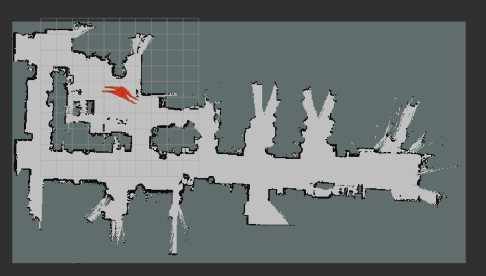

# Second Project - ROS2 Mapping and Navigation

[](https://docs.ros.org/en/humble/)
[](https://en.cppreference.com/)
[](https://navigation.ros.org/)
[](http://rtv.github.io/Stage/)

**Second Project** for the **Robotics course** — a 2D mapping and autonomous navigation system for an omnidirectional robot (AgileX Scout Mini) using ROS2.  
The system generates an occupancy grid map with SLAM Toolbox and navigates it autonomously with the Nav2 stack and Stage simulator.



---

## 📦 Features

- **Mapping pipeline**: converts 3D LiDAR pointcloud to 2D LaserScan and runs SLAM Toolbox (`sync` / `async`) to build the map.
- **Stage simulation**: loads the Task 1 `map.png` and a Scout Mini model with 360° laser.
- **Full Nav2 stack**: `map_server`, `amcl`, `planner_server`, `smoother_server`, `controller_server` (DWB), `behavior_server`, `bt_navigator`, managed by `lifecycle_manager`.
- **Goal publisher node (C++)**: reads `x,y,theta` goals from CSV and sends them sequentially via the `NavigateToPose` action — next goal only when the previous one succeeds or is aborted.
- **RViz visualization**: preconfigured views for mapping and navigation (map, TF, scans, particle cloud, global/local plan, goals).

---

## 🤖 Hardware & Simulation Setup

| Parameter | Value | Description |
|-----------|-------|-------------|
| Robot | AgileX Scout Mini | Omnidirectional kinematics (mecanum wheels) |
| Laser scanner | 360° FOV, 0.1 – 6.0 m | 720 samples in Stage, `pointcloud_to_laserscan` in mapping |
| Map resolution | 0.05 m/px | Must match Stage `resolution` and SLAM Toolbox |
| Map origin | `[-6.84, -10.5, 0.0]` | Real-world pose of bottom-left pixel (see `map/map.yaml`) |
| Robot footprint | radius 0.35 m (local) / 0.40 m (global) | Tuned for Stage environment |
| `use_sim_time` | `True` everywhere | Mandatory for bag playback (Task 1) and Stage (Task 2) |

---

## 🚀 Installation

### 1. Prerequisites

- ROS2 Humble (or later)
- Nav2 stack: `ros-humble-navigation2`, `ros-humble-nav2-bringup`
- SLAM Toolbox: `ros-humble-slam-toolbox`
- `pointcloud_to_laserscan`
- Stage simulator package `stage_ros2_stageros` (must be present in your workspace `src` before building)

```bash
sudo apt install ros-humble-navigation2 ros-humble-nav2-bringup \
  ros-humble-slam-toolbox ros-humble-pointcloud-to-laserscan
```

> ⚠️ **IMPORTANT:** place the folder containing the `stage_ros2_stageros` package inside the `src` directory of your `colcon_ws` before compiling.

### 2. Clone the repository

```bash
cd ~/colcon_ws/src
git clone https://github.com/francescomonticone/ROS2---mapping-and-navigation.git
```

### 3. Build the package

```bash
cd ~/colcon_ws
colcon build --packages-select second_project --symlink-install
source install/setup.bash
```

---

## ▶️ Usage

### Task 1 — Mapping (SLAM Toolbox)

Generate a 2D occupancy grid from the provided ROS 2 bag files.

**1. Launch mapping + RViz2:**

```bash
ros2 launch second_project mapping.launch.py
```

Optional arguments:

```bash
ros2 launch second_project mapping.launch.py slam_mode:=async rviz:=true
```

- `slam_mode`: `async` (default, recommended) or `sync`
- `rviz`: `true` / `false`

**2. Play the bag file (in a second terminal):**

```bash
ros2 bag play ~/bags/<bag_name> --clock
```

> ⚠️ The `--clock` flag is **mandatory** because all nodes use `use_sim_time := True`.

The launch file starts:
- `pointcloud_to_laserscan` (`/ugv/rslidar_points` → `/scan`, range 0.1–6.0 m, 360°)
- `slam_toolbox` in `mapping` mode (`UGV_odom` / `map` / `UGV_base_link`, resolution 0.05)
- `rviz2` with `rviz/mapping.rviz`

**3. Save the map:**

Once the bag finishes and the map is complete in RViz, save it (e.g. with `map_saver` or SLAM Toolbox serialize) and place `map.png` + `map.yaml` into `second_project/map/` for Task 2.

### Task 2 — Autonomous Navigation (Nav2 + Stage)

Run the full simulation and navigation stack with a single launch file:

```bash
ros2 launch second_project navigation.launch.py
```

This orchestrates:
- **Stage simulator** (`stage_ros2_stageros` + `world/task2.world` + Scout Mini)
- **Nav2 stack** managed by `lifecycle_manager` (5 s delayed start)
- **Custom `goal_publisher` node** (10 s delayed start, waits for Nav2 action server)
- **RViz2** with `rviz/nav2.rviz`

**Initial pose (if required):**

If the TF tree is not published immediately due to ROS 2 startup timings, click **"2D Pose Estimate"** in RViz2 on the robot start pose `(0, 0)` to wake up AMCL.

---

## 📊 Goals CSV File

`second_project/csv/goals.csv`:

```csv
x,y,theta
1.6,-4.4,-0.013
12.3,-4.0,1.513
12.5,0.0,-1.586
...
9.0,-2.1,-1.978
```

11 sequential goals. The `goal_publisher` sends goal *N+1* only when goal *N* succeeds or is aborted; on cancel/unknown result the sequence stops.

---

## 🧠 Nodes Overview

### `stageros` (Stage simulator)

- **Publishes:** `/odom`, `/base_scan`, TF chain `odom` → `base_footprint` → `base_link` → `base_laser_link`
- World file: `world/task2.world` (loads `map.png`, 28.8 × 15.35 m @ 0.05 m/px)
- Robot model: `world/scout_mini.inc` (omni drive, 0.612 × 0.580 m, laser 0.1–6.0 m / 360°)

### Nav2 stack

- `map_server` — serves `map/map.yaml` (`trinary` mode, 0.05 m/px)
- `amcl` — `nav2_amcl::OmniMotionModel`, `scan_topic: /base_scan`, `base_frame_id: base_footprint`, 500–2000 particles
- `planner_server` — `GridBased` planner plugin
- `smoother_server` — `nav2_smoother::SimpleSmoother`
- `controller_server` — `dwb_core::DWBLocalPlanner` with omnidirectional velocities (`max_vel_x/y: 0.45 m/s`, `max_vel_theta: 0.9 rad/s`)
- `behavior_server` + `bt_navigator` — recovery behaviors and BT navigation
- `lifecycle_manager_navigation` — autostart for all of the above

### `goal_publisher` (custom C++ node)

- **Source:** `src/goal_publisher.cpp`
- **Parameters:** `csv_path` (default: `share/second_project/csv/goals.csv`), `action_name` (`navigate_to_pose`), `frame_id` (`map`)
- **Subscribes to:** NavigateToPose action feedback/result
- **Publishes to:** `navigate_to_pose` action goal (`position.x/y` + yaw → quaternion)
- **Logic:** waits for action server, sends goals sequentially, skips aborted goals, shuts down after the last goal.

---

## ⚙️ Nav2 Configuration

Config file: `second_project/config/nav2_params.yaml`

| Component | Key setting |
|-----------|-------------|
| AMCL | `robot_model_type: nav2_amcl::OmniMotionModel`, `laser_max_range: 6.0`, `laser_min_range: 0.1` |
| Controller (DWB) | omni `min/max_vel_x/y: ±0.45 m/s`, critics: `RotateToGoal, Oscillation, BaseObstacle, GoalAlign, PathAlign, PathDist, GoalDist` |
| Local costmap | rolling window 4×4 m, `robot_radius: 0.35`, `inflation_radius: 0.8` |
| Global costmap | `robot_radius: 0.40`, `inflation_radius: 1.0` |
| Goal checkers | `xy_goal_tolerance: 0.25 m`, `yaw_goal_tolerance: 0.30 rad` |

SLAM Toolbox mapping params: `second_project/config/slam_toolbox_mapping.yaml` (Ceres solver, `resolution: 0.05`, `max_laser_range: 6.0`, loop closure enabled).

---

## 🖥️ RViz Configuration

**Navigation** (`rviz/nav2.rviz`, fixed frame `map`):
- `/map`, TF tree, `/base_scan`, `/particle_cloud`, `/plan`, `/local_plan`, `/goal_pose`, grid

**Mapping** (`rviz/mapping.rviz`):
- `/map`, `/scan` LaserScan, TF, SLAM Toolbox pose graph

Both configs are auto-loaded by their respective launch files via `get_package_share_directory()` — no absolute paths.

---

## 🗺️ Map Files

```
second_project/map/
├── map.png        # occupancy grid image (576×307 px @ 0.05 m/px)
├── map.yaml       # origin [-6.84, -10.5, 0.0], trinary mode
└── serialized/    # SLAM Toolbox session (map.data + map.posegraph)
```

The same `map.png` is also referenced by `world/task2.world` for Stage.


---

## 📌 Important Notes

- Always **source** your workspace after building:

  ```bash
  source ~/colcon_ws/install/setup.bash
  ```

- All nodes use **simulated time**. Bag playback requires `--clock`; Stage publishes sim time automatically.

- Stage's laser topic is hardcoded as `base_scan` in `stageros` source — `nav2_params.yaml` already sets `scan_topic: /base_scan` and `base_frame_id: base_footprint` to match.

- The launch files use `get_package_share_directory()` / `FindPackageShare` to locate configs, worlds, maps, CSV and RViz files — no absolute paths.

---

## 📄 License

Distributed under the MIT License. See `LICENSE` for more information.

---

## ✍️ Authors

- Francesco Monticone — [@francescomonticone](https://github.com/francescomonticone)
- Alessandro Minestrini
  
  Robotics Course — Politecnico di Milano
